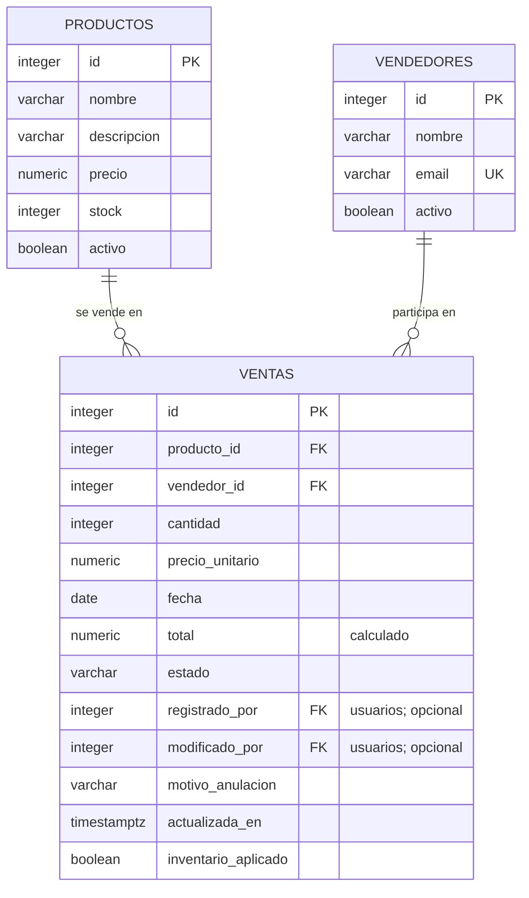

# Base de datos de Autos

Este apartado reúne los archivos de base de datos para la prueba técnica. Las tres tablas principales son **productos, vendedores y ventas**. El proyecto añade usuarios, movimientos de inventario y auditoría para manejar los permisos y conservar el historial.

## Archivos para revisar

| Requisito | Archivo |
| --- | --- |
| Diagrama relacional de las tres tablas principales | [Diagrama en SVG](diagrama-relacional.svg), listo para abrir o adjuntar. |
| Creación de tablas, relaciones y reglas de negocio | [schema.sql](schema.sql). Es el esquema completo generado desde las migraciones. |
| Cinco registros de prueba por tabla principal | [seed.sql](seed.sql). Incluye productos, vendedores y ventas, además de las entradas de inventario necesarias. |
| Cuentas locales de prueba (opcional) | [seed-usuarios.sql](seed-usuarios.sql). Administrador, vendedor e inventario; conserva las cuentas que ya existan. |
| Historial de cambios del esquema | [migrations/](migrations/). |

## Relaciones

Un producto puede aparecer en muchas ventas, y un vendedor puede registrar muchas ventas. Cada venta referencia exactamente un producto y un vendedor. El usuario autenticado que registra la operación se guarda por separado del vendedor comercial.



El diagrama se centra en las tres tablas pedidas. Las referencias de autor apuntan a `usuarios`, que forma parte de las ampliaciones del proyecto y se crea en `schema.sql`.

### Claves y restricciones

- Las tres tablas tienen `id` como clave primaria, generado con `GENERATED ALWAYS AS IDENTITY`.
- `ventas.producto_id` referencia `productos.id` y `ventas.vendedor_id` referencia `vendedores.id`. Son obligatorias y usan `ON DELETE RESTRICT` para impedir borrar registros con ventas asociadas.
- `vendedores.email` es único y se almacena en minúsculas.
- La cantidad de una venta debe ser positiva; los precios y el stock no pueden ser negativos.
- El total es una columna calculada: `cantidad × precio_unitario`. El cliente no lo envía.
- Los índices de producto y vendedor facilitan la consulta de sus ventas.

Las migraciones añaden las reglas de stock, anulación e historial. Crear una venta descuenta existencias; anularla devuelve las unidades aplicadas una sola vez. Si una regla falla, PostgreSQL revierte la operación completa.

## Instalar el esquema y los ejemplos

Con una base vacía y el `.env` configurado, desde la carpeta del backend:

```powershell
node --env-file=.env scripts/prepare-local-db.js
npm.cmd run db:setup
```

Esto crea la base si hace falta, aplica las migraciones y carga los ejemplos. Si la base ya tiene datos del proyecto, usa `npm.cmd run db:migrate` para aplicar cambios pendientes sin repetir la carga.

Si necesitas revisar la entrega solo con SQL, puedes usar pgAdmin: conecta a una **base vacía**, ejecuta primero `schema.sql` completo y después `seed.sql` completo. No combines esta instalación con la ejecución manual de las mismas migraciones. El esquema ya incorpora su historial para que después se pueda usar `db:migrate`.

`seed.sql` depende del esquema completo porque las ventas actualizan el inventario. No debe ejecutarse únicamente sobre la migración inicial de tres tablas ni sobre una base ya poblada. En una instalación nueva, las identidades de los ejemplos empiezan en 1.

## Datos de ejemplo

La carga crea cinco productos, cinco vendedores y cinco ventas. Antes de vender, registra una entrada de 100 unidades por producto.

| Producto | Precio por unidad | Cantidad vendida | Total de la venta | Stock restante |
| --- | ---: | ---: | ---: | ---: |
| Filtro de aceite | 25.000 | 2 | 50.000 | 98 |
| Aceite de motor | 45.000 | 3 | 135.000 | 97 |
| Pastillas de freno | 120.000 | 1 | 120.000 | 99 |
| Bujía | 18.000 | 4 | 72.000 | 96 |
| Limpiaparabrisas | 35.000 | 1 | 35.000 | 99 |

Los importes de la tabla están expresados en COP. No se incluyen cuentas de acceso ni contraseñas predeterminadas; el primer administrador se crea como se explica en el [README del backend](../README.md).

Si quieres las cuentas de prueba ya utilizadas durante el desarrollo, abre `seed-usuarios.sql` en pgAdmin y ejecútalo sobre la base del proyecto, después de `schema.sql` o de aplicar todas las migraciones. Este archivo opcional crea las cuentas `admin@example.com`, `ventas@example.com` e `inventario@example.com` con los roles ADMIN, VENDEDOR e INVENTARIO. Usa hashes scrypt de las credenciales de prueba acordadas y no modifica las cuentas existentes. La consulta final muestra los correos, roles y estados, sin hashes. No debe usarse en producción.

Para consultar los conteos después de una instalación nueva:

```sql
SELECT 'productos' AS tabla, count(*) AS registros FROM productos
UNION ALL
SELECT 'vendedores', count(*) FROM vendedores
UNION ALL
SELECT 'ventas', count(*) FROM ventas;
```

El resultado esperado es 5 para cada tabla. Una base que ya se ha usado desde la aplicación puede tener otros conteos.

## Verificación sin modificar los datos actuales

```powershell
node --env-file=.env scripts/verify-database-delivery.js
```

El script instala `schema.sql` y `seed.sql` en un esquema temporal dentro de una transacción. Comprueba los cinco registros por tabla principal, las claves primarias, las dos relaciones principales, los totales y el stock. Al terminar revierte la transacción, incluso si la comprobación falla. Necesita permiso para crear esquemas, pero no cambia los registros de la aplicación.

Si modificas las migraciones, regenera `schema.sql` con `npm.cmd run db:schema` y vuelve a ejecutar la verificación. La instantánea no se edita a mano.
